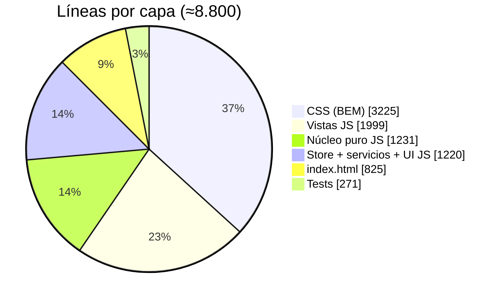
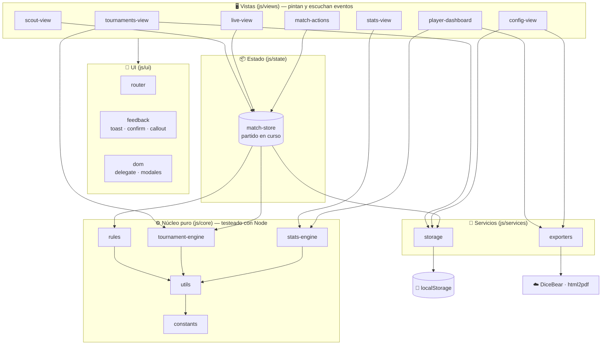
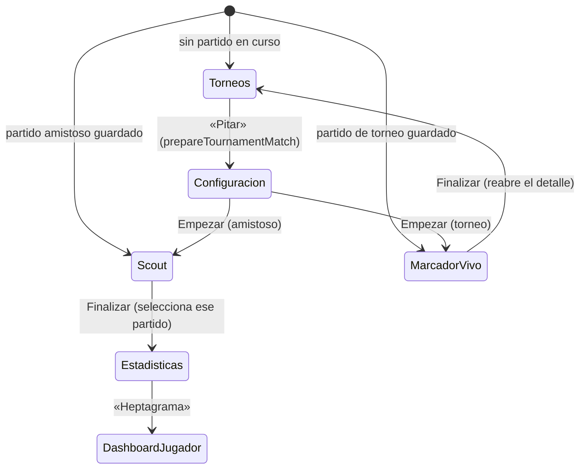
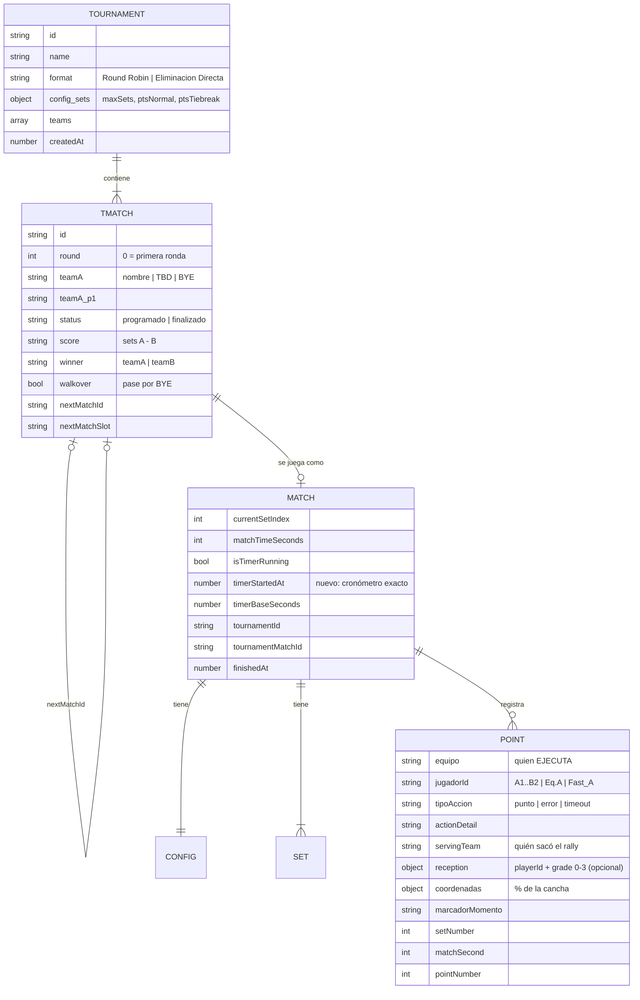
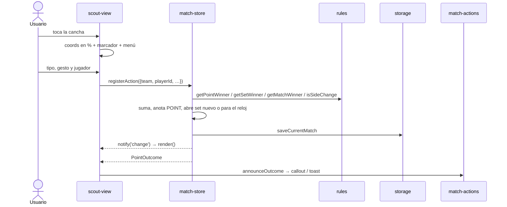
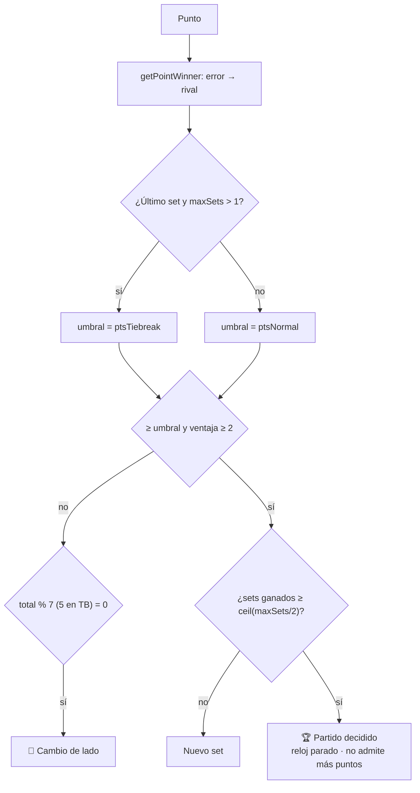
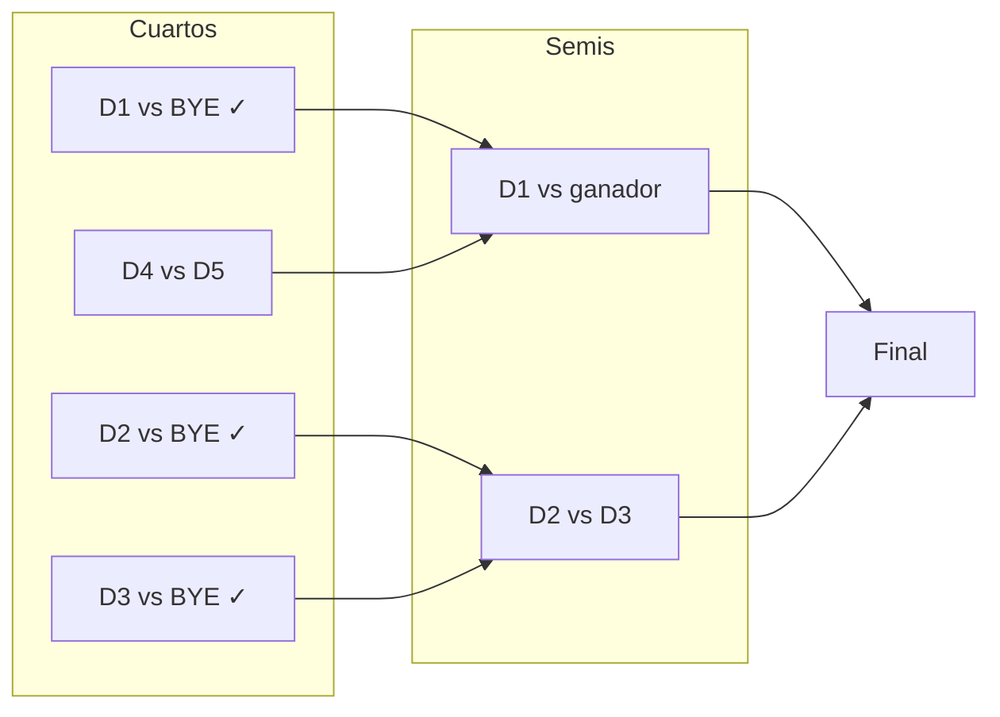
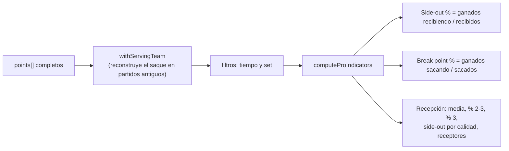
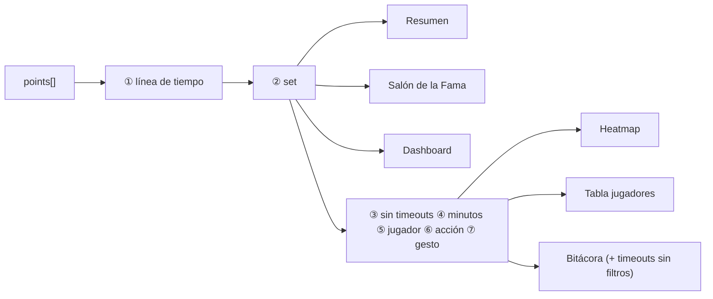

# 🏐 Voley Playa Scout — Guía de Arquitectura (v2)

> Referencia para entender **cómo está construido el proyecto**: módulos, flujo de datos, persistencia, reglas de juego, convenciones (BEM, comentarios) y cómo probarlo.
> Los diagramas están en **Mermaid** (se ven en GitHub y en VS Code con *Markdown Preview Mermaid Support*).

---

## 1. ¿Qué es?

Una **SPA 100 % frontend** para entrenadores y analistas de voley playa 2 vs 2:

- **Torneos**: Round Robin (con tabla de clasificación) o Eliminación Directa (llaves con pases automáticos por BYE), campeón y progreso.
- **Scout táctico**: se toca la cancha donde cayó el balón y se elige jugador, punto/error y gesto técnico.
- **Marcador Vivo**: marcador grande tipo TV, con atajos de teclado.
- **Estadísticas**: partido en curso o cualquiera del historial, filtros, línea de tiempo animada, heatmap, Salón de la Fama, bitácora y dashboard por jugador (radar + PDF/CSV/JSON).
- **Datos**: `localStorage` con copia de seguridad (exportar/importar).

| Aspecto | Detalle |
|---|---|
| Stack | HTML5 + **Bootstrap 5.3.9** (sólo CSS) + CSS propio con BEM + JavaScript vanilla (ES2020), **sin build** |
| Externos | Bootstrap 5.3.9 (jsDelivr + SRI) · `html2pdf.js 0.10.1` (CDN) · Google Fonts *Outfit* · API **DiceBear** (avatares SVG) |
| Ejecutar | Abrir `index.html` en el navegador (funciona con `file://`) |
| Tests | `npm test` → `node --test` (Node ≥ 18, sin instalar nada) |

---

## 2. Estructura de archivos

```
voley playa/
├── index.html                 Vistas, modales (<dialog>), plantillas y carga de scripts
├── package.json               Sólo el script "test"
├── css/                       Se cargan DESPUÉS de bootstrap.min.css (el orden importa)
│   ├── tokens.css             Variables de diseño + temas (classic / dark / high-contrast)
│   ├── bootstrap-theme.css    Puente: tokens → variables --bs-* (btn, card, form, table, nav…)
│   ├── base.css               Fondo, márgenes de Reboot, accesibilidad, keyframes
│   ├── layout.css             app-header, app-main, view, bottom-nav
│   ├── components.css         Modificadores BEM de Bootstrap (btn--pulse, card--glass…) y
│   │                          bloques propios: app-dialog, avatar, kpi, zone-bar, toast-stack…
│   ├── court.css              court, court-zone, court-marker, heat-dot, legend
│   ├── tournaments.css        tournament-card, team-row, match-card, bracket, manual-set
│   ├── match.css              team-form, sets-tracker, match-clock, scoreboard,
│   │                          action-menu, player-btn, timeout-btn, live-board
│   └── stats.css              stats, summary, player-stat, fame-card, filters,
│                              timeline, player-dash, skill-tile, export-btn
├── js/
│   ├── core/                  ⚙️ PURO: sin DOM ni storage → testeable en Node
│   │   ├── constants.js       Reglas por defecto, claves de storage, gestos técnicos…
│   │   ├── utils.js           escapeHtml, formatDuration, metros, avatares, CSV…
│   │   ├── rules.js           Motor de reglas: sets, partido, cambio de lado, validación
│   │   ├── tournament-engine.js  Generación de llaves, BYE, resultados, clasificación
│   │   └── stats-engine.js    Filtros, marcador, totales, premios, perfil de jugador
│   ├── services/
│   │   ├── storage.js         ÚNICO acceso a localStorage + backup
│   │   └── exporters.js       Descargas PDF / CSV / JSON / backup
│   ├── state/
│   │   └── match-store.js     Store del partido en curso (patrón observador)
│   ├── ui/
│   │   ├── dom.js             Selectores, delegación de eventos, modales
│   │   ├── feedback.js        toast, callout, confirm (Promise), spinner
│   │   └── router.js          Navegación entre vistas
│   ├── views/                 Una por pantalla: sólo pintan y escuchan eventos
│   │   ├── match-actions.js   Deshacer / finalizar / anunciar (compartido Scout + Vivo)
│   │   ├── tournaments-view.js
│   │   ├── config-view.js
│   │   ├── scout-view.js
│   │   ├── live-view.js
│   │   ├── player-dashboard.js
│   │   └── stats-view.js
│   └── main.js                Arranque
└── tests/                     node:test sobre js/core/*
```



---

## 3. Arquitectura en capas

Regla de oro: **las dependencias sólo van hacia abajo**. El núcleo no sabe que existe el DOM; las vistas no tocan `localStorage`.



### Patrones aplicados

| Patrón / práctica | Dónde | Por qué |
|---|---|---|
| **Módulos IIFE + namespace `VP`** | Todos los `js/*` | Encapsulan; funcionan con `file://` (los ES Modules no). Los de `core/` además exportan `module.exports` para Node. |
| **Store + observador** | `match-store.js` | Única fuente de verdad; las vistas se suscriben a `'change'` / `'tick'` y se repintan. |
| **Funciones puras** | `core/*` | Lógica de dominio aislada y cubierta por 29 tests. |
| **Repositorio** | `storage.js` | Un solo punto de lectura/escritura, tolerante a JSON corrupto. |
| **Delegación de eventos** | `dom.delegate` | Sustituye a los `onclick="fn('${nombre}')"` inline (rompían con apóstrofes y exigían globales). |
| **Escapado de HTML** | `utils.escapeHtml` | Todo texto del usuario pasa por aquí antes de `innerHTML` (anti-XSS). |
| **`<dialog>` nativo** | Todos los modales | Foco atrapado, Escape, backdrop y apilado gratis. |
| **Popover API** | toasts y callouts | Para pintarse **encima** de los `<dialog>` (top layer). |
| **Plantillas `<template>`** | Fila de dupla | Marcado declarativo en HTML, clonado con JS. |
| **Puente de tema** | `css/bootstrap-theme.css` | Bootstrap se personaliza reasignando sus variables `--bs-*` a nuestros tokens: sin Sass, sin tocar su CSS y con los 3 temas funcionando. |
| **Constantes centralizadas** | `constants.js` | Añadir un gesto técnico o cambiar una regla en un solo sitio. |

---

## 4. Vistas y navegación



| Vista | `data-view` | Notas |
|---|---|---|
| Torneos | `vista-torneos` | Siempre disponible |
| Config | `vista-configuracion` | Partido, tema, backup, borrado total |
| Marcador | `vista-marcador-vivo` | Habilitada sólo con partido en curso |
| Scout | `vista-registro` | Habilitada sólo con partido en curso |
| Stats | `vista-estadisticas` | Siempre disponible (historial) |

---

## 5. Datos y persistencia

### 5.1 Claves de `localStorage` (compatibles con la v1)

| Clave | Contenido |
|---|---|
| `voley-currentMatch` | Estado del `match-store` |
| `voley-lastMatch` | Último partido finalizado |
| `voley-history` | `Array` de partidos finalizados (lo lee el selector de Stats) |
| `voley-tournaments` | `Array` de torneos |
| `voley-theme` | `classic` · `dark` · `high-contrast` (texto plano) |

Los datos antiguos se **migran solos**: `match-store.load()` completa campos nuevos y `tournament-engine` deduce rondas y ganadores de torneos sin `round`/`winner`, y repara BYE atascados.

### 5.2 Modelo



**Regla clave:** `punto` suma al equipo del jugador; `error` suma al **rival** (`rules.getPointWinner`).

---

## 6. Flujos principales

### 6.1 Registrar un punto (Scout)



### 6.2 Motor de reglas



### 6.3 Llaves de eliminación directa

Se usa el **orden estándar de cabezas de serie** (`bracketSeedOrder`): para 8 plazas `[1,8,4,5,2,7,3,6]`. Los BYE son las semillas más altas, así que **nunca hay BYE vs BYE** y los pases se resuelven solos (`resolveByes`).



### 6.4 Indicadores profesionales (side-out, break point, recepción)

Cada rally guarda **quién sacó** (`servingTeam`, calculado por `rules.getServingTeam`: saca quien ganó el
rally anterior; el primer rally de cada set lo saca el equipo que toca por alternancia según
`config.firstServer`) y, opcionalmente, **la recepción** (`reception: { playerId, grade }`, escala 0-3).



`withServingTeam` debe aplicarse a la bitácora **completa** antes de filtrar, porque la reconstrucción
necesita la secuencia entera. En partidos antiguos sin `firstServer` se asume que sacó primero el equipo A.

### 6.5 Pipeline de estadísticas



---

## 7. Convenciones de código

### CSS — Bootstrap 5.3 + BEM

**Regla:** si Bootstrap lo resuelve, se usa Bootstrap; lo que no cubre, se escribe con BEM.

| Necesidad | Se resuelve con |
|---|---|
| Rejilla, espaciado, flex, tipografía, visibilidad | Utilidades de Bootstrap: `row`, `col-*`, `g-*`, `vstack`, `gap-*`, `d-flex`, `text-body-secondary`, `d-none d-sm-table-cell`… |
| Botones, tarjetas, formularios, tablas, pestañas, barras, avisos, badges | Componentes de Bootstrap: `btn btn-primary`, `card`, `form-control`, `form-select`, `btn-check`, `table`, `nav-underline`, `progress`, `toast`, `badge`, `alert`, `btn-close`, `spinner-border` |
| Identidad visual (naranja, arena, radios, sombras) | `css/bootstrap-theme.css`: reasigna las variables `--bs-*` a nuestros tokens. **Nunca** editar `bootstrap.min.css` |
| Variante de un componente de Bootstrap | Modificador BEM sobre su bloque: `btn--pulse`, `btn--dashed`, `btn--team-a`, `card--glass`, `card--narrow`, `progress--thin`, `toast--success` |
| Piezas del dominio | Bloques BEM propios: `court`, `heat-dot`, `scoreboard`, `match-card`, `bracket`, `reception`, `versus`, `live-board`… |

```
.bloque              → componente propio                   .match-card
.bloque__elemento    → parte interna                       .match-card__team-name
.bloque--modificador → variante / estado                   .match-card--finished
```

- **Modales:** no se usa `.modal` de Bootstrap (requiere su JS). Los diálogos son `<dialog>` nativos con el
  bloque BEM `app-dialog`, que ya trae foco atrapado, Escape y apilado. Tampoco se carga `bootstrap.bundle.js`.
- **Tema oscuro:** `config-view.applyTheme()` pone `data-theme` (nuestros tokens) y `data-bs-theme`
  (modo de color nativo de Bootstrap) en el `<body>`.
- **Estados de JS:** se usan las clases de estado de Bootstrap (`.active`, `.show`) o modificadores BEM
  (`view--active`, `reception__grade--active`).
- **Ojo con `.vstack`:** además de `display:flex` fuerza `align-self: stretch`; un bloque que deba quedar
  centrado dentro de la vista necesita `align-self: center` en su CSS (ver `.scout`).
- Una sola clase por selector en el CSS propio (especificidad plana). Nada de `#id`.
- **Mix** permitido cuando un nodo es dos bloques: `class="card card--glass filters"`.
- Colores siempre con **tokens** (`var(--color-surface)`), nunca valores fijos en componentes → los 3 temas funcionan en toda la app.
- Mostrar/ocultar con el atributo HTML `hidden` (gana siempre gracias a `[hidden]{display:none!important}`).
- **Cero estilos inline** en el HTML. Sólo JS asigna `left/top/width` dinámicos.

### JavaScript

- Cada archivo empieza con un bloque `@file` que explica su responsabilidad.
- Funciones públicas documentadas con **JSDoc** (`@param`, `@returns`, `@typedef`).
- Comentarios del **por qué**, no del qué.
- `'use strict'`, `const` por defecto, sin variables globales salvo `window.VP`.
- Todo texto del usuario → `escapeHtml()` antes de `innerHTML`, o `textContent`.

---

## 8. Cómo probar

```bash
npm test          # 29 tests unitarios de js/core (reglas, saque, torneos, estadísticas)
```

Además, durante el desarrollo se usó una prueba end-to-end con Chrome headless (Puppeteer, fuera del repo) con 56 comprobaciones: partidos completos, deshacer entre sets, filtros, dashboard y radar, torneos con BYE, resultado manual, Marcador Vivo con teclado, tema oscuro, móvil sin scroll horizontal, migración de datos v1, backup y descargas PDF/CSV/JSON.

---

## 9. Guía rápida: dónde tocar para…

| Quiero… | Dónde |
|---|---|
| Añadir un gesto técnico | Sólo `SKILLS` en `js/core/constants.js` (menú, filtros, premios, radar y CSV se generan solos) |
| Cambiar reglas de set / cambio de lado | `DEFAULT_RULES`, `SIDE_CHANGE_EVERY` en `constants.js`; lógica en `core/rules.js` |
| Puntos de clasificación Round Robin | `STANDING_POINTS` en `constants.js` |
| Nuevo formato de torneo | `core/tournament-engine.js` (+ tests) y `views/tournaments-view.js` |
| Nueva métrica del jugador | `computePlayerProfile` en `core/stats-engine.js` → `player-dashboard.js` → `exporters.js` |
| Nuevo tema | Bloque `[data-theme="…"]` en `css/tokens.css` + opción en el `theme-picker` de `index.html`; si es oscuro, `data-bs-theme="dark"` en `applyTheme()` |
| Nueva vista | `<section class="view">` + botón `bottom-nav__item[data-view]` + `VP.router.register()` en su archivo de vista |
| Cambiar persistencia (p. ej. backend) | Sólo `js/services/storage.js` |

---

## 10. Cambios respecto a la v1 (marzo 2026)

**Bugs corregidos:** BYE que nunca avanzaban · bitácora sin metros · borrado total que no borraba torneos · cronómetro congelado tras recargar · XSS / nombres con apóstrofe · resultado manual fijo a 3 sets y sin validar · ganador del cuadro comparado como texto · partidos a 1 set jugados a 15 · se podía seguir anotando con el partido terminado · `finishMatch` aceptaba empates en torneo · radar que ignoraba el color (`var()` en canvas) · descargas CSV que se cortaban con `#` · tema oscuro con tarjetas blancas fijas · empezar un partido de torneo sobrescribía el partido en curso.

**Funcionalidades nuevas:** clasificación Round Robin · campeón y barra de progreso · nombres de ronda en las llaves · historial de partidos en Estadísticas · copia de seguridad · avisos no bloqueantes y diálogos accesibles · atajos de teclado en Marcador Vivo · indicador de saque en Scout · avisos de fin de set y cambio de lado también en Scout · cronómetro que arranca con el primer punto · timeouts visibles en la bitácora · filtros con nombres de jugadores · botón «Limpiar filtros» · jugadores de cada dupla guardados en el torneo.

**Deuda técnica pendiente:** las vistas aún generan HTML con template strings (un micro-framework de componentes sería el siguiente paso) · no hay tests automáticos de UI dentro del repo · los avatares dependen de un servicio externo (DiceBear) y no funcionan sin conexión · Bootstrap se carga por CDN: sin conexión la app pierde los estilos (para una PWA conviene copiarlo a `vendor/`).
