<div align="center">

# 🏐 Voley Playa Scout

**Scouting, torneos y estadísticas en tiempo real para voley playa 2 vs 2.**
Registra cada punto tocando la cancha, organiza torneos y analiza el rendimiento de cada jugador,
todo desde el navegador y sin instalar nada.


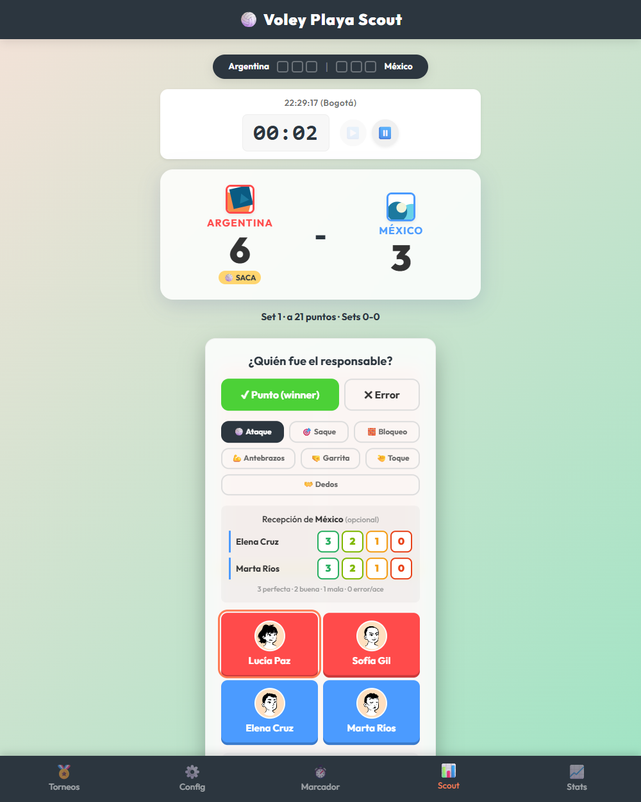

</div>

---

## 📑 Contenido

- [Características](#-características)
- [Capturas](#-capturas)
- [Inicio rápido](#-inicio-rápido)
- [Guía de uso](#-guía-de-uso)
- [Reglas implementadas](#-reglas-implementadas)
- [Arquitectura](#-arquitectura)
- [Estructura del proyecto](#-estructura-del-proyecto)
- [Desarrollo](#-desarrollo)
- [Datos y privacidad](#-datos-y-privacidad)
- [Compatibilidad](#-compatibilidad)
- [Roadmap](#-roadmap)

---

## ✨ Características

### 🏅 Torneos
- **Round Robin** (todos contra todos) con **tabla de clasificación**: victoria = 2 pts, derrota = 1 pt, desempate por diferencia de sets.
- **Eliminación directa** con cuadro de llaves por rondas (cuartos, semis, final), cabezas de serie y **pases automáticos por BYE**.
- Campeón, barra de progreso, edición de duplas y carga manual del resultado con validación por sets.
- Al «Pitar» un partido, la configuración (duplas, jugadores y reglas) se precarga sola.

### 💰 Premios (opcional por torneo)
- **Inscripción por jugador** (la dupla paga el doble) y casillas **«¿Pagó?»** jugador a jugador, al crear el torneo o después.
- La **bolsa se calcula sobre lo pagado**, nunca sobre lo esperado; se muestran aparte lo **esperado** y lo **pendiente**.
- **% para premios** y el resto para **administración**; reparto por puestos: *el ganador se lleva todo*, *Top 2*, *Top 3* o **personalizado**.
- Montos **exactos en pesos colombianos** (sin redondear a miles y sin perder ni un peso en el reparto).
- Ganadores asignados solos: clasificación en Round Robin y, en eliminación directa, los semifinalistas **comparten el 3.º-4.º**.
- **Copiar resumen** para pegar en WhatsApp (bolsa, reparto y quién debe).

### 🎯 Scout táctico
- Cancha de **8 m × 16 m** con **zona libre** alrededor para marcar balones que caen fuera.
- Por cada acción: **punto (winner)** o **error no forzado**, **jugador** y **gesto técnico** (Ataque, Saque, Bloqueo, Antebrazos, Garrita, Toque, Dedos).
- Marcador automático (un error suma al rival), sets, tie-break, **tiempos muertos**, indicador de saque y avisos de **fin de set** y **cambio de lado**.
- **Calidad de recepción (0-3)** opcional en cada rally: un toque sobre el receptor registra quién recibió y cómo.
- **Cronómetro oficial** (arranca solo con el primer punto y sobrevive a recargas) y reloj de referencia de Bogotá.
- **Deshacer** cualquier acción, incluso la que cerró un set.

### ⏱️ Marcador vivo
- Marcador grande tipo TV con botones +1 por equipo, pensado para torneos.
- **Atajos de teclado** para anotar sin mirar la pantalla.

### 📊 Estadísticas
- Analiza el **partido en curso o cualquiera del historial**.
- Resumen (marcador, sets, duración), desglose por jugador y **Salón de la Fama** con 9 premios.
- **Indicadores profesionales**: **side-out %** (puntos ganados recibiendo), **break point %** (puntos ganados sacando), aces, errores de saque, **recepción media 0-3**, % de recepciones positivas, **side-out según la calidad de recepción** y ranking de receptores. Los partidos antiguos también los muestran: el saque se reconstruye a partir de la secuencia de puntos.
- **Filtros** por jugador, tipo de acción, gesto, set y rango de minutos, además de una **línea de tiempo animada** que reproduce el partido.
- **Mapa de calor** numerado (los errores llevan borde) y **bitácora** con coordenadas en metros.

### 👤 Dashboard de jugador
- KPIs: **+/-**, **eficiencia neta**, **puntos clutch** (marcador ajustado) y minuto más productivo.
- Distribución por zonas, heatmap personal y **heptagrama** (radar de los 7 gestos).
- Exportación a **PDF**, **CSV** (compatible con Excel) y **JSON**.

### 🧰 Datos, temas y accesibilidad
- Todo se guarda en el navegador, con **copia de seguridad** para exportar e importar.
- Tres temas: **Clásico**, **Oscuro** y **Alto contraste** (lectura bajo sol directo).
- **Español / inglés** con el selector **ES · EN** de la cabecera (se recuerda la elección).
- Diseño responsive pensado para el móvil a pie de pista, diálogos accesibles con teclado y avisos que no bloquean la pantalla.

---

## 📸 Capturas

| Llaves de eliminación directa | Clasificación Round Robin |
|:---:|:---:|
| 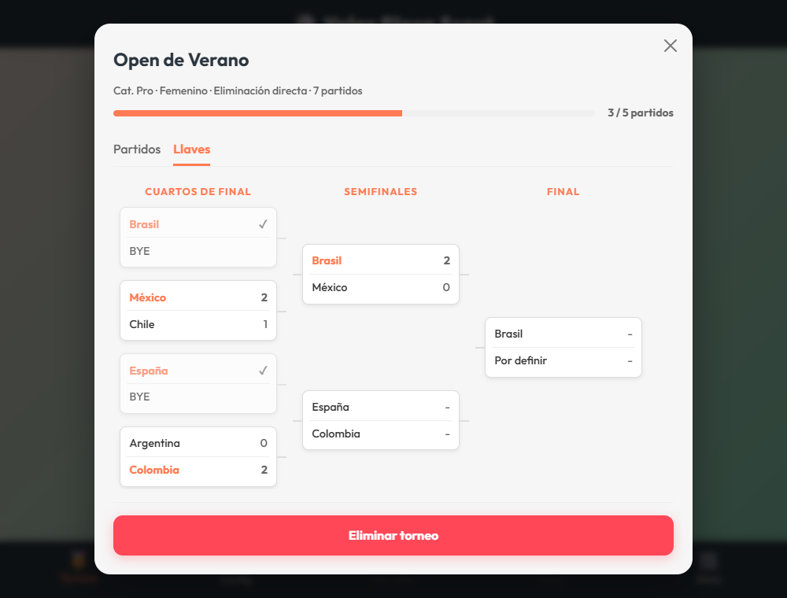 | 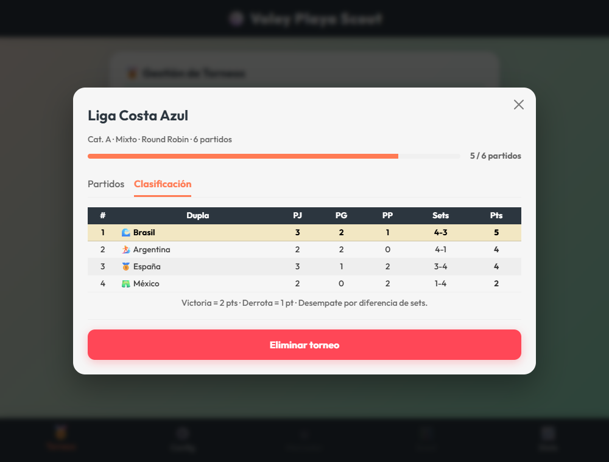 |
| **Estadísticas del partido** | **Mapa de calor** |
| 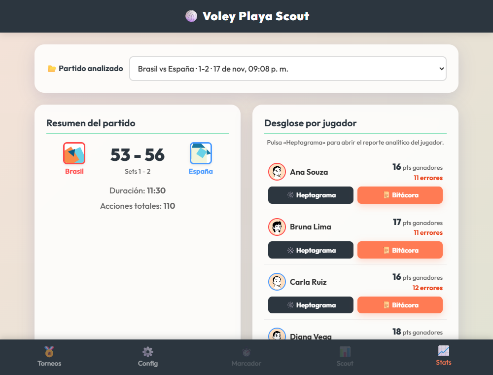 | 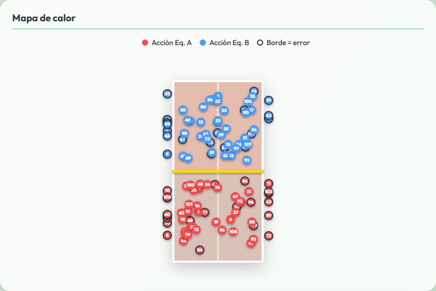 |
| **Dashboard del jugador** | **Heptagrama de habilidades** |
| 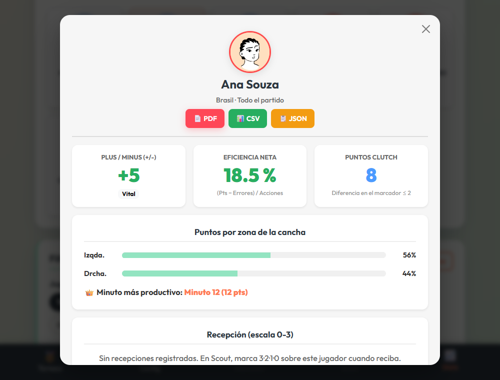 | 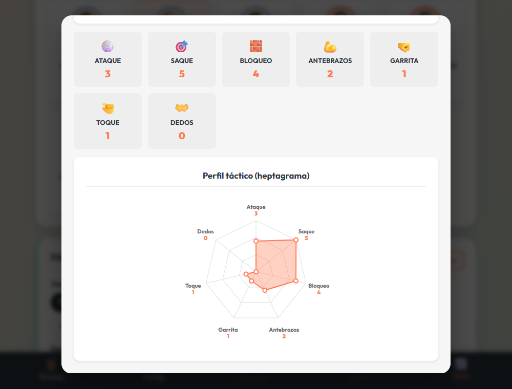 |

| Salón de la Fama | Marcador vivo (móvil) | Tema oscuro (móvil) |
|:---:|:---:|:---:|
| 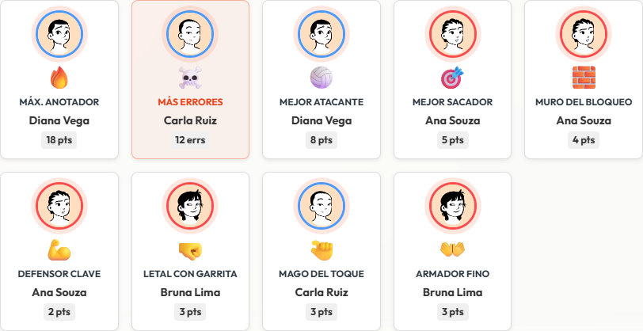 | 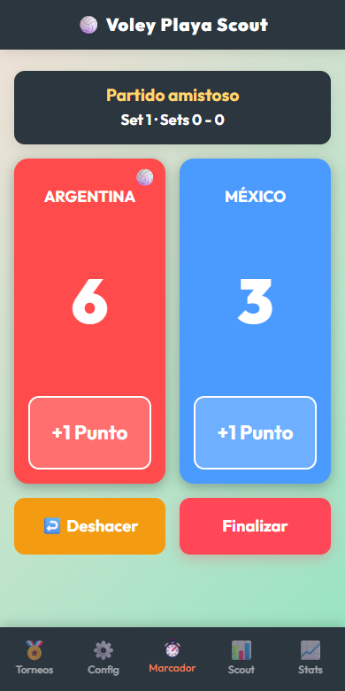 | 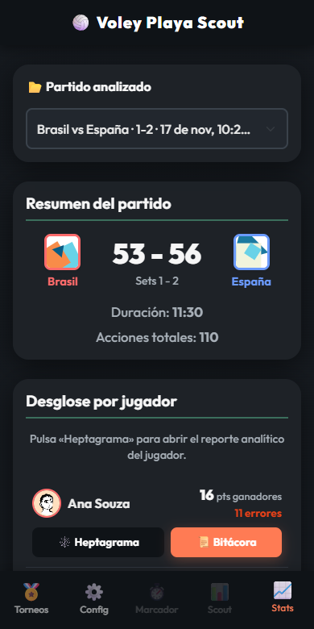 |

---

## 🚀 Inicio rápido

No necesita servidor, base de datos ni `npm install`.

```bash
git clone git@github.com:jackmaf/board_beachvoley.git
cd board_beachvoley
```

Después, **abre `index.html`** en el navegador (doble clic). Si lo prefieres, sírvelo en local:

```bash
python3 -m http.server 8000      # → http://localhost:8000
# o bien
npx serve .
```

> La primera carga necesita internet para Bootstrap, las fuentes, los avatares y la librería de PDF. Sin conexión
> la app funciona, pero sin avatares ni exportación a PDF.

---

## 📖 Guía de uso

### Partido amistoso
1. **Config** → nombres de las duplas y los jugadores, reglas (sets y puntos) y **saque inicial** → **Empezar partido**.
2. **Scout** → toca la cancha donde cayó el balón → elige **Punto/Error**, el **gesto**, opcionalmente la **recepción** (3·2·1·0 sobre quien recibió) y el **jugador** responsable.
3. Al terminar → **Finalizar y guardar partido**: se abre **Stats** con ese partido.

### Partido de torneo
1. **Torneos** → **Crear nuevo torneo** → duplas, formato y reglas. Opcional: **Activar premios** (inscripción, % y reparto) y marca quién pagó.
   Los pagos se siguen marcando en la pestaña **💰 Premios** del torneo.
2. En el detalle, **🏐 Pitar** un partido → revisa la configuración precargada → **Empezar partido**.
3. Anota en **Marcador** y pulsa **Finalizar**: el ganador avanza solo en el cuadro.
4. ¿Ya tienes el resultado? Usa **Colocar marcador** para cargarlo set a set.

### Atajos de teclado (Marcador vivo)

| Tecla | Acción |
|---|---|
| <kbd>A</kbd> o <kbd>←</kbd> | Punto para el equipo A |
| <kbd>L</kbd> o <kbd>→</kbd> | Punto para el equipo B |
| <kbd>Z</kbd> | Deshacer la última acción |
| <kbd>Esc</kbd> | Cerrar el modal o el menú de acción |

---

## 📐 Reglas implementadas

| Regla | Valor por defecto | Configurable |
|---|---|---|
| Modalidad | Al mejor de 3 sets | 1, 3 o 5 sets |
| Puntos por set | 21 | ✅ |
| Puntos del tie-break (último set) | 15 | ✅ |
| Ventaja mínima para cerrar un set | 2 puntos | — |
| Tiempos muertos | 1 por equipo y set | — |
| Saque | Saca quien gana el rally; el saque inicial se alterna en cada set | Saque inicial |
| Calidad de recepción | 3 perfecta · 2 buena · 1 mala · 0 error/ace (positiva = 2-3) | — |
| Cambio de lado | Cada 7 puntos (5 en tie-break) | — |
| Clasificación Round Robin | Victoria 2 pts · derrota 1 pt | — |

Los valores fijos están centralizados en [`js/core/constants.js`](js/core/constants.js).

---

## 🏗️ Arquitectura

App de una sola página en **JavaScript vanilla, organizada por capas**. Las dependencias solo van
hacia abajo: la lógica de dominio no conoce el DOM y las vistas nunca tocan `localStorage`.

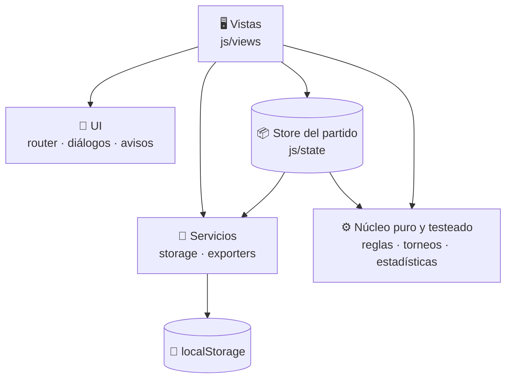

- **Núcleo puro** (`js/core`): reglas, torneos y estadísticas como funciones sin efectos secundarios, cubiertas por tests.
- **Store** (`js/state/match-store.js`): única fuente de verdad del partido. Las vistas se suscriben y se repintan solas.
- **Scripts clásicos** con el namespace global `VP`, para que la app funcione al abrir `index.html` directamente (`file://`), algo que los ES Modules no permiten.
- **Bootstrap 5.3** (sólo CSS) para componentes, rejilla y utilidades, adaptado a la identidad de la app mediante sus variables `--bs-*`; los bloques propios del dominio (cancha, marcadores, llaves…) con **BEM** (`bloque__elemento--modificador`).

📘 La documentación técnica completa, con diagramas de flujo, modelo de datos y convenciones, está en **[CLAUDE.md](CLAUDE.md)**.

---

## 🗂️ Estructura del proyecto

```
board_beachvoley/
├── index.html               Vistas, modales (<dialog>) y carga ordenada de scripts
├── css/                     Estilos propios (se cargan DESPUÉS de Bootstrap)
│   ├── tokens.css           Variables de diseño y temas
│   ├── bootstrap-theme.css  Puente: tokens → variables --bs-* de Bootstrap
│   ├── base.css             Fondo, accesibilidad y animaciones
│   ├── layout.css           Cabecera, vistas y navegación inferior
│   ├── components.css       Bloques BEM genéricos: diálogo, avatar, KPI, avisos…
│   ├── court.css            Cancha, mapa de calor y leyenda
│   ├── tournaments.css      Torneos, partidos y llaves
│   ├── match.css            Configuración, Scout y Marcador vivo
│   ├── stats.css            Estadísticas y dashboard de jugador
│   └── prizes.css           Premios: ajustes, reparto y pagos
├── js/
│   ├── core/                Lógica pura: constants, utils, rules, tournament-engine, prize-engine, stats-engine
│   ├── i18n/                Diccionarios es.js / en.js (formato i18next)
│   ├── services/            storage (localStorage + backup), i18n y exporters (PDF/CSV/JSON)
│   ├── state/               match-store: partido en curso
│   ├── ui/                  dom, feedback (toasts y confirmaciones), router y language (selector ES/EN)
│   ├── views/               Una vista por pantalla
│   └── main.js              Arranque
├── tests/                   Tests unitarios del núcleo (node:test)
├── docs/screenshots/        Capturas de este README
├── CLAUDE.md                Guía de arquitectura
└── package.json             Sólo el script de tests (sin dependencias)
```

---

## 🛠️ Desarrollo

### Requisitos
- Un navegador moderno (ver [Compatibilidad](#-compatibilidad)).
- **Node.js ≥ 18**, solo para ejecutar los tests.

### Tests

```bash
npm test
```

Ejecuta 44 tests unitarios con el runner nativo de Node (`node:test`), sin instalar nada. Cubren el
motor de reglas y del saque, la generación de llaves y los BYE, la clasificación, los premios (pagos, bolsa y reparto exacto),
los filtros, los KPIs, los indicadores profesionales (side-out, break point y recepción) y que los diccionarios
de español e inglés estén completos.

### Convenciones

| Ámbito | Convención |
|---|---|
| CSS | **Bootstrap primero** (componentes y utilidades); lo que Bootstrap no cubre, con **BEM**. Sin `#id` ni estilos inline; colores siempre con tokens `var(--color-…)` |
| JavaScript | Un módulo por archivo, bloque `@file` + **JSDoc**, `'use strict'`, texto del usuario siempre con `escapeHtml()` |
| Formato | [`.editorconfig`](.editorconfig): UTF-8, LF y 4 espacios (2 en JSON/YAML) |
| Commits | [Conventional Commits](https://www.conventionalcommits.org/es/) con emoji: `✨ feat(scout): …`, `🐛 fix(stats): …` (agente [`committer`](.claude/agents/committer.md)) |

### Recetas rápidas

| Quiero… | Dónde |
|---|---|
| Añadir un gesto técnico | Solo en `SKILLS` de `js/core/constants.js`: menú, filtros, premios, radar y CSV se actualizan solos |
| Cambiar una regla del juego | `js/core/rules.js` y sus tests en `tests/rules.test.js` |
| Crear un tema nuevo | Bloque `[data-theme="…"]` en `css/tokens.css` y su opción en el selector de `index.html` (los componentes de Bootstrap lo heredan vía `css/bootstrap-theme.css`) |
| Cambiar dónde se guardan los datos | Solo `js/services/storage.js` |

---

## 🔒 Datos y privacidad

- **Todo se guarda en tu navegador** (`localStorage`). No hay servidor ni cuentas, y los datos no se envían a ningún sitio.
- Como los datos viven en un solo navegador, usa **Config → Copia de seguridad** para exportarlos o pasarlos a otro dispositivo.
- **Servicios externos** que se cargan desde internet:
  - [DiceBear](https://www.dicebear.com/) genera los avatares a partir de los **nombres de jugadores y equipos**, que viajan en la URL de la imagen.
  - [jsDelivr](https://www.jsdelivr.com/) sirve **Bootstrap 5.3.9** e **i18next 23.16.8** (traducciones), ambos con hash de integridad SRI. Sin conexión, los textos siguen funcionando con un traductor de respaldo incluido en la app.
  - [cdnjs](https://cdnjs.com/) sirve `html2pdf.js` para exportar a PDF.
  - [Google Fonts](https://fonts.google.com/) sirve la tipografía *Outfit*.
- Los archivos exportados (`VoleyPlaya_*.pdf/csv/json`) están en el `.gitignore` para que no se suban por error.

---

## 🌐 Compatibilidad

| Navegador | Versión mínima |
|---|---|
| Chrome / Edge | 119+ |
| Firefox | 125+ |
| Safari (macOS / iOS) | 17+ |

La app usa `<dialog>`, la Popover API y `:user-invalid`. En navegadores más antiguos sigue
funcionando, pero los avisos pueden quedar detrás de los modales.

---

## 🗺️ Roadmap

**Hecho en la v2**
- [x] Arquitectura modular por capas con tests, Bootstrap 5.3 y CSS BEM.
- [x] Torneos: clasificación Round Robin, llaves con BYE automáticos y campeón.
- [x] Historial de partidos en Estadísticas y copia de seguridad.
- [x] Exportación a PDF, CSV y JSON.
- [x] Avisos no bloqueantes, diálogos accesibles y atajos de teclado.
- [x] Premios por torneo: inscripciones, pagos por jugador, bolsa y reparto.
- [x] Interfaz en español e inglés.

**Próximamente**
- [ ] Instalable como **PWA** y uso 100 % sin conexión (incluidos los avatares).
- [ ] Comparativa de un jugador a lo largo de varios partidos.
- [ ] Tests end-to-end dentro del repositorio.

---

<div align="center">

Desarrollado con ❤️ para la comunidad de voley playa.

</div>
